# OpenTDU2

[](https://github.com/CamilleKMI/OpenTDU2/actions/workflows/macos.yml)
[](https://github.com/CamilleKMI/OpenTDU2/actions/workflows/linux.yml)
[](https://github.com/danny199012/OpenTDU2/actions/workflows/windows.yml)


OpenTDU2 is an open source re-implementation (C++17 / Vulkan / Jolt Physics) of the engine of
**Test Drive Unlimited 2** (Eden Games, 2011).

📸 **[Screenshot gallery](https://github.com/danny199012/OpenTDU2/issues/2)** — 565 screenshots of the
fixes and new features, organized by area, hosted outside the repo so clones stay small.

The project is built on the structure of
[OpenTestDriveUnlimited](https://github.com/opentestdriveunlimited/OpenTestDriveUnlimited) (OpenTDU, the TDU1
re-implementation). It uses the same conventions: `GS*` game services, `GM*` game modes, original file formats
read as they are, the Jolt physics library, and D3D9 → SPIR-V shader translation through DXVK's DXSO compiler.

The original game is **not** included. OpenTDU2 reads the *unpacked* files of a legal copy (`Euro/Bnk`,
`Euro/Shaders`, ...: the layout used by the TDU2 Universal Launcher, not the `.big` archives).

Everything is read from the game files or from the **readable** code of `TestDrive2.exe`. About 3 MB of the
executable is encrypted by SecuROM; that part is never decrypted or bypassed. When a behaviour lives only there,
OpenTDU2 follows the data and marks the choice as inferred (`[INF]` in the code and in `docs/re/*.md`). See
[Grey areas](#grey-areas-what-is-approximate-and-why).

## Legal notice

OpenTDU2 is an **unofficial fan project**, maintained non-commercially. It is not affiliated with, endorsed by or
connected to Nacon / Bigben, Eden Games, Atari or any other rights holder of *Test Drive Unlimited 2*. All
trademarks and copyrights belong to their respective owners and are used here for identification only.

* **No game data is distributed** — not in this repository, not in any release. The port reads the unpacked files
  of a copy you must already own; it is not a replacement for the game.
* **No DRM circumvention** — the SecuROM-encrypted part of `TestDrive2.exe` is never decrypted, extracted or
  bypassed, and no code or tool here enables it.
* **Non-commercial** — nothing here is sold, gated or paywalled.
* **Compliance** — rights holders: open a GitHub issue marked `legal` or contact the repository owner. A written
  request about any material in this repository or in a release will be answered and actioned promptly; we would
  rather fix a complaint than contest one.

See `NOTICE` for the full licence scope (what is GPL and what is not).

## Project workflow

Three agent branches (`win` hub, `glm`, `cline`) feed `main`. The contract that
keeps them in step is **`RULES.md`**: sync before work, every report carries a
build id, WIP is flagged, session start/end checklists. **`PROGRESS.md`** is the
status board (Done / WIP / Partial / Not started / Blocked / Open, with owner,
evidence and next step) — GitHub renders it and the *Status board* action
validates it on every push.

Every run identifies itself: the build id (`build N (hash) · branch`) is drawn
top right, carried in the window title and the log banner, and **burnt into the
bottom-right corner of every test/debug screenshot** (the photo camera's player
photos stay clean), so a bug report always says which build it came from.
`check-build.ps1` prints the stamp, whether the exe matches the sources, the
sync state and the current WIP block in one shot.

## Screenshots

| | |
|---|---|
| 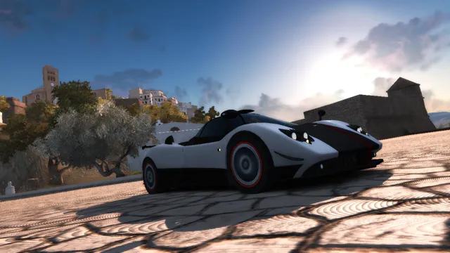 Press START screen (real-time cinematic of `press_start.bnk`) | 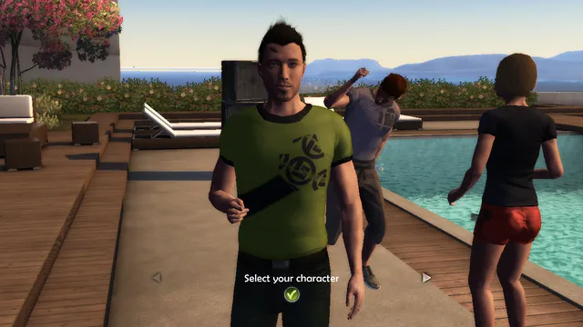 "Select your character" (C_AVATAR party in slow motion) |
| 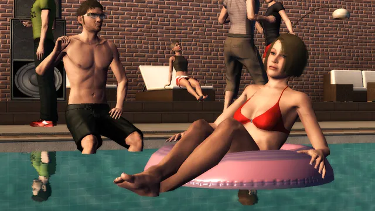 C_INTRO: pool water (refraction), reflections, avatar skin and faces | 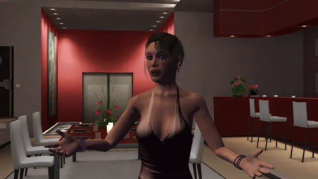 C_TESS: Tess talking (FaceFX lip sync), lighting from the house lamps |
| 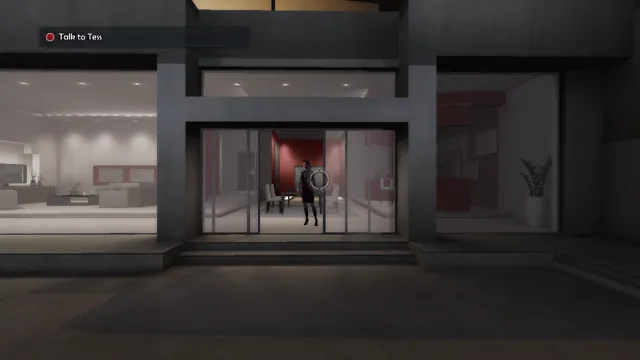 First-person walk mode, goal "Talk to Tess", reticle | 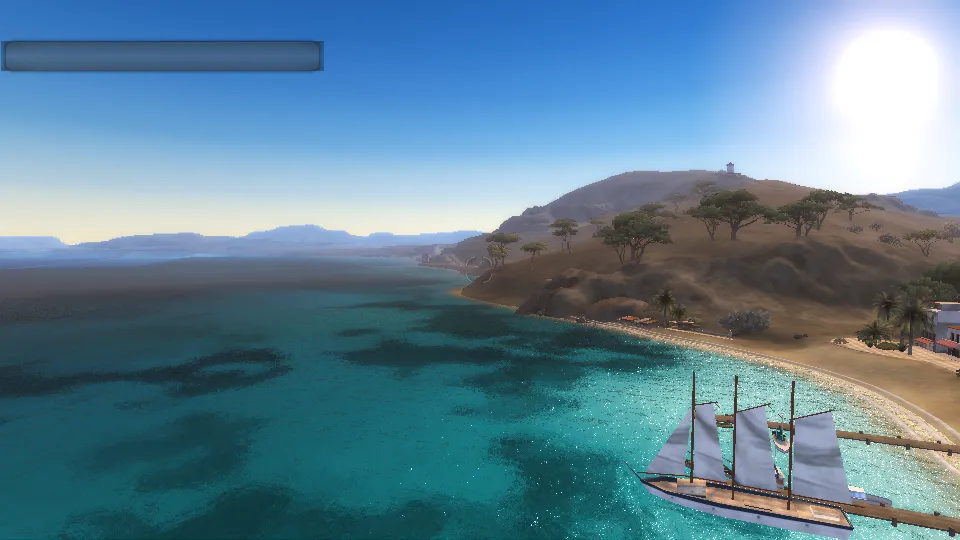 Ocean and shore foam over the bay |
| 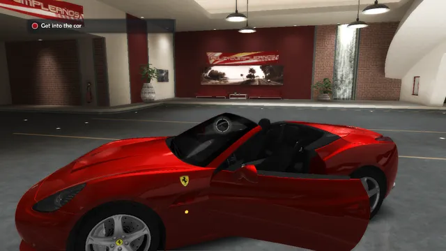 FIRST_WM garage: the California, roof down, driver door opening, untinted glass | 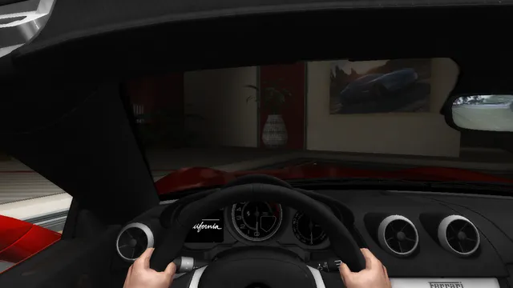 Seated in the cockpit, hands on the wheel |
| 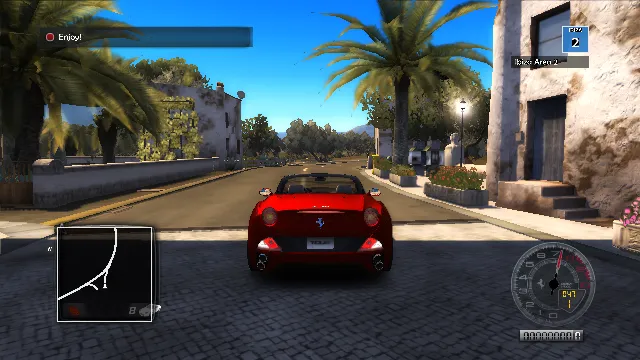 First Freeride: driving the California in Ibiza (Bienvenidos village) | 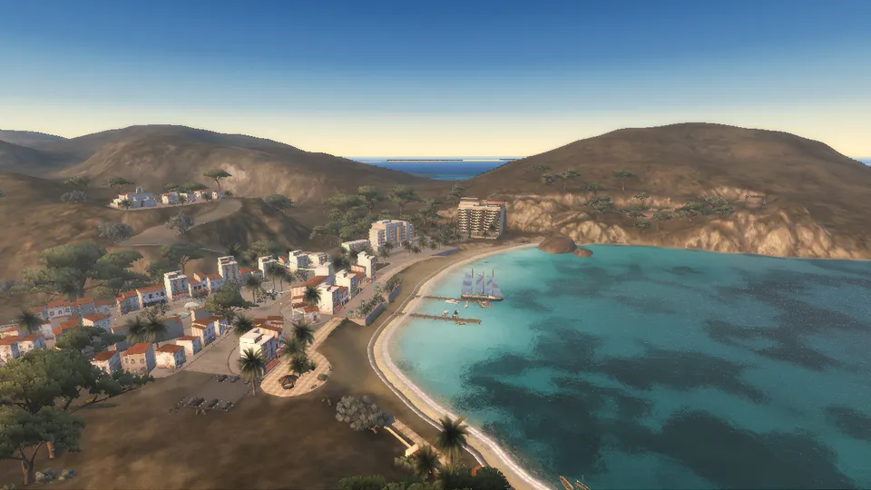 World viewer, Ibiza: village, beach and tall ship near the intro party house (spot `EPH_L3DI`, weather `19.30`) |
| 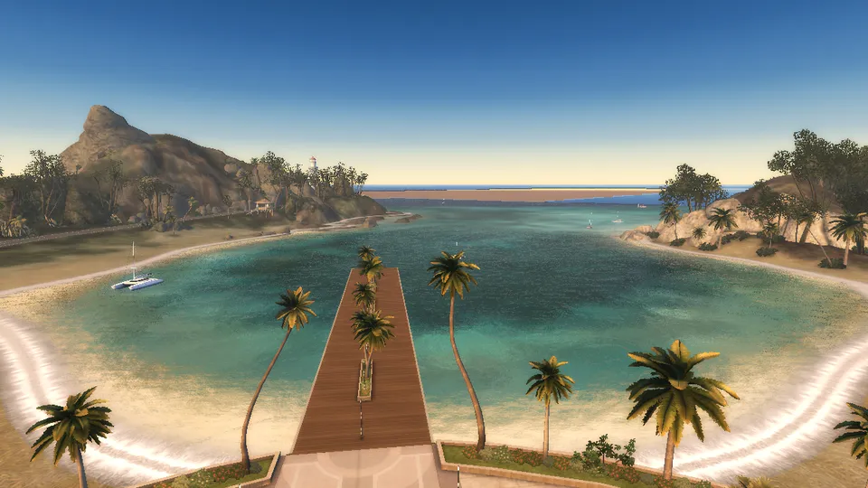 World viewer, Casino island: the bay and pier at sunset (weather `19.30`) | 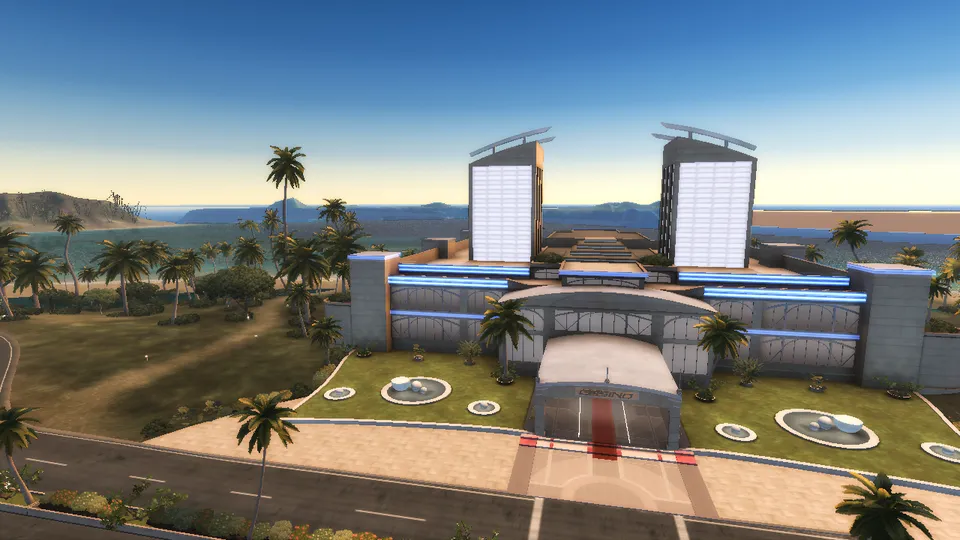 World viewer, Casino island: the casino (weather `19.30`) |
| 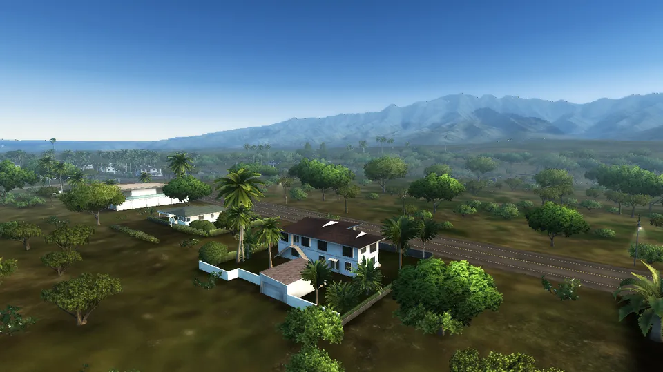 World viewer, Hawai (Oahu): houses and palms near spot `ETUN_G`, mountains behind (weather `18`) | |

## Build and run on macOS (Apple Silicon or Intel)

Requirements:

* Xcode Command Line Tools: `xcode-select --install`
* CMake ≥ 3.24 and Ninja: `brew install cmake ninja`
* The **LunarG Vulkan SDK** (provides MoltenVK): <https://vulkan.lunarg.com/sdk/home#mac>. It can simply be
  unpacked into `~/VulkanSDK/<version>`; the build script and the game find it there.
* Network access for the first `cmake` run: SDL3, volk, Vulkan-Headers, VMA, Jolt Physics, Dear ImGui and stb
  are fetched with `FetchContent`.

Build:

```sh
cd OpenTDU2
./build_macos.sh                 # configure + build in Release (folder build/)
```

or by hand:

```sh
cmake -S . -B build -G Ninja -DCMAKE_BUILD_TYPE=Release
cmake --build build --parallel
```

Run:

```sh
./build/bin/opentdu2                          # game data found automatically (see below)
./build/bin/opentdu2 -game /path/to/TestDrive2
```

The game data folder is looked up in this order: `-game <folder>`, the `OTDU2_GAME_DIR` environment variable,
the current folder, then the parent folders of the executable that contain `Euro/Bnk`. If the project sits
inside the game folder (`TestDrive2/OpenTDU2`), nothing has to be set.

Linux works too (tested with Mesa / llvmpipe). Windows builds with MSVC — see [Build and run on Windows](#build-and-run-on-windows).

### World viewer (developer tool)

A free-fly camera over an island, like OpenTDU's world viewer (game mode `WORLD_VIEWER`, not a TDU2 mode):

```sh
./launch_world_viewer.sh                 # Ibiza
./launch_world_viewer.sh casino          # Casino island directly (also: hawai, eden)
./launch_world_viewer.sh hawai -game /path/to/TestDrive2 -weather 18
```

The script finds the game data like the game does (`-game`, `OTDU2_GAME_DIR`, the parent folders of the
repository, a `TestDrive2` folder next to them, `~/TestDrive2`) and passes any other option to `opentdu2`
(`./build/bin/opentdu2 -gm WORLD_VIEWER -island casino` is the same thing).

* **Map editor** (panel section): places the mods-overlay props (`<mods>/props/*.obj`) at a position with
  heading / scale, snaps to the ground, commits to `<mods>/props.txt` (the `fuel` checkbox makes the prop a
  working gas station) and reloads them in place; the placed lines list back into the editor for updates.

* Look: hold the right mouse button (or the left one outside the panel); Tab = capture the mouse (look without a
  button, Tab again to release).
* Move: W / S (or Up / Down) = forward / backward along the view, A / D (or Left / Right) = strafe,
  E / Space / Page Up = up, Q / Ctrl / Page Down = down, **Shift = speed x2**, mouse wheel = base speed (x1.1 per
  notch, like OpenTDU), the camera stays 1.5 m above the loaded terrain ("ground clamp").
* Panel (ImGui, F2 hides it): island Ibiza / Hawai / Casino (also F5 / F6 / F7; the world is unloaded and the
  new island loaded), position / speed, base speed, FOV, sector radius, weather (`game_weathers.xmb`), spot
  exteriors, and the `spots.bin` list (click = teleport; the number is how many of the 9 sector banks around the
  spot are installed).
* Streaming follows the camera: the sectors around it (radius 1, `-sectorradius n`) are loaded and the ones two
  rows away unloaded; every area bank, the island ocean and the island level heightfield (`<island>.bnk`, drawn
  where no area is loaded) stay loaded; spot exteriors (`exterior/<spot bank>.bnk`) within 1.5 km.
* Missing banks are skipped with a warning (partial game data). The start position is the `spots.bin` spot with the
  most sector banks installed around it (`-spot <bank name>` to choose, `-campos x,y,z -camyaw deg -campitch deg`
  to place the camera, `-flyspeed m/s`, `-noexteriors`).

### Command line options

| Option | Effect |
|---|---|
| `-game <folder>` | game root folder (the one that contains `Euro/`) |
| `-lang fr` | text language (`db_<lang>.cpr`); default: system language |
| `-w`, `-fullscreen`, `-width N`, `-height N`, `-novsync` | video (otherwise `SystemPC.cpr`) |
| `-gm <mode>` / `-intro` | start in a game mode: `LOGIN`, `AVATAR_CHOICE`, `FIRST_WM`, `FREERIDE`, `CASINO`, `WORLD_VIEWER` (tool) |
| `-casinochips N` | CASINO: starting chip balance (otherwise the profile's) |
| `-money N` / `-chips N` | developer cheats: the profile's money / the casino chips at startup (any mode) |
| `-cheatspanel` / `-cheat <row>[,<row>]` / `-tpdestination <name>` | developer cheats: open the panel at startup (also **F4**, or a D-pad circle three times with X on a pad) / apply the retail dev menu's delock rows: `allcars`, `houses`, `allroads`, `allspots`, `buyable`, `achievements` / teleport to a quick destination once the drive runs: `Airport`, `Casino`, `Ferrari dealer`, `Any dealer`, `Tuning shop`, `Car wash`, `Race school`, `Clothes shop` (`docs/re/cheats.md`) |
| `-maptab <n>` / `-logspots` / `-logbrands` | the world map (`docs/re/map_spots_spec.md`): open pinned to tab n (0 challenges, 2 avatar spots, 3 "Spots for Vehicles" - a test hook; the movie's lit row still follows clicks) / the spot dump (bank, icon, dealer logo cell, discovered state) / the `DBBrands` logo table |
| `-tpin x,z[,heading]` | FREERIDE: teleport the running car (the in-game path; `-tp` only moves the spawn) |
| `-home` | FREERIDE: spawn at the home house's entrance (the profile's `home_house`, its `spots.bin` record's second point) instead of the story wake-up |
| `-housegarage` / `-nofurniture` | FREERIDE: walk straight into a house's garage room when entering it (test) / skip the house furniture slots |
| `-walkat x,y,z,yaw` | pin the first walk's scene-local start pose (test: the interior walk scripts); the later room swaps keep their own cameras |
| `-emote <label>` / `-logemotes` | **emotes** (`docs/re/emotes_spec.md`): play a walk-mode emote on the walk start — `hello`, `cheers`, `funny`, `followme`, `angry`, `sad`, `strong`, `laugh` (the retail `em_*.anm` of `avatarsdriver.bnk`, self-view third person) / the self view in-out and clip log. In the walk modes: **X** toggles the self view, **1..8** the slots, the view returns at the clip end; the EMOTES panel (Dear ImGui) picks them too |
| `-nointeriorworld` | FREERIDE: a house's living room as the closed-room frame instead of its streamed island (`docs/re/houses_spec.md` 9.2) |
| `-houseworld` | FREERIDE: stream the island around a house's *living room* (default: the closed-room frame; `docs/re/houses_spec.md` 9.2) |
| `-replayhouseintro` | FREERIDE: replay a house's entry cinematic even though the profile has seen it (`house_intros_seen`) |
| `-dealer <n\|spot>` / `-carpos <spot>[,<spot>]` | FREERIDE: open a `DBCarShop` by index or `_spot_name` (test) / dump a shop's `Entity__CarPos` (`docs/re/car_delivery.md`) |
| `-switchcar` / `-switchparts <parts>` | FREERIDE: allow the runtime car change after a purchase (known to wedge the device) / narrow a hang in it |
| `-casinoseed N` | CASINO: fixed RNG seed (a reproducible automated run) |
| `-slotselftest N` / `-rouletteselftest N` / `-pokerselftest N` | CASINO: run the return self test (n spins / hands) and exit |
| `-logcasino` | CASINO: dump the `DBCasino*` tables and the profile's progress on them |
| `-casinomovie` / `-dumpcasinolabels` | CASINO: draw the retail `Casino.vmf` / dump its timelines (`docs/re/casino_spec.md` §5) |
| `-casinoroom <hall\|slots\|roulette\|poker\|vip\|dressing\|shop>` | CASINO: boot straight into a casino interior room (`docs/re/casino_spec.md` §9) |
| `-nocasinointerior` / `-nocasinointeriorto` | CASINO: the old native floor list instead of the 3D casino / skip a room's `C_INTRO` |
| `-casinoselect <n>` / `-casinoprize <car\|clothes>` | CASINO test hooks: play the n-th machine / table of the loaded room / pay a slot-machine prize |
| `-noslothud` / `-logslothud` | CASINO: the native slot text instead of the retail `Cas_SlotMachine.vmf` / `Cas_SlotScreen.vmf` HUD / log its FSCommands (`docs/re/casino_spec.md` §9.6) |
| `-dumpcasinomovie <movie>` | CASINO: dump any movie's root timeline, clip tree and functions (`cas_slotmachine`, `cas_slotscreen`, `main`...) |
| `-slotscreenpanel` / `-slotscreenclear` / `-reelspeedscale <f>` / `-nocasinoneonlight` / `-dumpcasinoentities <s>` | CASINO: the credit screen as a 2D panel / red-clear its render target / slow the reels / the neon props unlit / dump an entity array's fields (`docs/re/casino_spec.md` §9.7) |
| `-noclipextent` / `-logfonts` / `-logkeymap` | Flash A/B: `_width` / `_height` undefined as before / log every movie font record / log the keyboard bindings |
| `-island <name>` | WORLD_VIEWER: `ibiza` (default), `hawai`, `casino` |
| `-gm assetviewer` / `-assets` | OpenTDU2 tool: the **asset viewer** (browse banks, **search every bank**, preview textures / models / movies / sounds, label assets); `-bank <path>` opens one, `-asset <name>` selects an asset, `-pickat x,y` picks a mesh at a pixel of the 3D view (a click) |
| `-labellint` / `-labellabels` | check / list `docs/re/asset_labels.txt` against the game data |
| `-buildindex` / `-search <text>` | ASSET_VIEWER: build `<userdata>/asset_index.txt` (every bank's assets + entities, ~30 s once) / run a cross-bank search at startup |
| `-entity <name>` / `-entitytab` / `-camera <name>` / `-collision` | ASSET_VIEWER: open the Entities tab on one entity / the bank's entity cameras / the collision wireframe |
| `-noscene` / `-noturntable` / `-island <name>` | ASSET_VIEWER: no 3D view (and no model loads) / a still camera / the island the shared material library comes from |
| `-pickcheck` / `-pickscan` / `-logscenedraws` | ASSET_VIEWER: pick the projected centre of every model / log a grid of pick rays / log how many meshes the 3D view drew |
| `-skipintro` | AVATAR_CHOICE: skip C_INTRO, straight to "Select your character" |
| `-walkmode n` | AVATAR_CHOICE: avatar n (1..6) chosen, straight to the house walk mode |
| `-avatar <config>` | FIRST_WM / FREERIDE started directly: DBPNJ avatar config (default `AVT_Male_Intro`) |
| `-allowskip` | FIRST_WM: the garage intro can be skipped |
| `-skipcine` | FREERIDE: skip C_FIRST_OUTRO, start on the road |
| `-playername <name>` | name shown in "Starring" **and written as `name` in `profile.sav`** (applied after the save is loaded, so the launcher's Player page wins over an old save; it also pre-fills the login's retail **New profile** dialog; default: system user name) |
| `-tester <name>` / `-nowatermark` | the build watermark: `<name> · build N (hash) · branch` top right (with no `-tester` the build id alone is drawn — always on since 2026-11-03; `RULES.md` §6) / never draw it, for pixel-identical A/B runs (`source/debug/watermark_overlay.*`). Every test/debug screenshot also carries a burnt-in `BUILD N HASH BRANCH` corner stamp, independent of this switch (the photo camera's player photos stay clean), and its path may use `{build}` / `{hash}` / `{branch}` |
| `-onlineusername <name>` / `-onlineserver <host>` | the launcher's Online page: logged at startup and stored for the networking work; nothing connects yet |
| `-envquality n` | `ENVIRONMENT_QUALITY_LEVEL_n` of `Quality_Settings.cpr` (0..3, default 3 = max; the game without a save uses 1) |
| `-profile <name>` | **quality preset** for this run: `high`, `medium`, `low`, `60`, `steamdeck`, `legiongo` — the same presets as the Advanced settings row (window size, render scale, shadows, water reflection rate, draw distance, HUD detail, 60 fps cap). Not saved; `-width` / `-height` after it still win |
| `-hudquality 1\\|2` | HUD detail override: 1 = minimap + built-in gauge, 2 = the HUD / GAUGES Flash movies |
| `-oceanreflections n` | water mirror refresh: 0 = render once (static), 1 = every frame (default), N = every Nth frame |
| `-drawdistance n` | streamed vegetation / props draw distance, 50..150 % of the distance in the game data (default 100) |
| `-nolodgeometry` | A/B: the V/O `.pmi` instances draw LOD 0 only (the pre-session-88 behaviour). The default loads the INS. LOD1/LOD2 geometry and switches level by distance — trees draw their `TD_Impostor` quad beyond √lodDistance[0] (`docs/re/pmi_streaming_spec.md` 9 #3) |
| `-shadowdistance n` | sun shadow caster range, 50..150 % of the game's `SET_SHADOW_CONFIG_MAX_CAST_DIST` (FREERIDE 736 m; default 100) |
| `-FORCELOGINCINEINDEX n` / `-cine n` | title screen cinematic (0..3, `entities.xmb` order); R key = next one |
| `-nosob` | do not use the original `.sob` shaders for the 2D layer |
| `-vk_enable_validation_layer` | Vulkan validation layers |
| `-verbose` | detailed log in `opentdu2.log` |
| `-watchdog <s>` / `-nowatchdog` / `-watchdoglog <path>` | **frame loop watchdog**: when no frame has run for `<s>` seconds (default 5) the phase that stopped, the frame and how long are written to the log and to `opentdu2-watchdog.log` / turn it off / its own file (`-watchdogtest <ms>` freezes the loop once to check it) |
| `-watchdogkill <s>` | **unresponsive-app kill** (default 60 s, `0` = off): when no frame has run for `<s>` seconds the watchdog thread terminates the process itself (exit code `0x43544157`) instead of leaving a wedged app / a busy GPU on the machine; the phase that hung is in `opentdu2-watchdog.log`. A debugger attached suppresses it (breakpoints freeze all threads); the known-long jobs beat through it (`-scantunnels`, the asset index build). `-watchdogtest 65000` demonstrates it end to end |
| `-imguiscale <f>` / `-imguifont <path>` | **UI scale** of the ImGui panels (cheats **F4**, advanced settings **F2**, the asset/world viewers, the coords overlay): force the scale (default: the monitor's scale, so the text stays a normal physical size on high-DPI screens; `1` = the classic 13 px bitmap-font look; the cheats panel has a live **UI scale** slider) / the TTF font to load when the scale is not 1 (default: a system font per OS) |
| `-scantunnels` / `-nocarve` / `-noprunecarve` | world diagnostics: scan **every sector bank** of the island (one at a time, headless — pair with `-exitframe`) and log each tunnel / bridge node whose footprint crosses the heightfield (`docs/STATE.md` session 56: 17 nodes on Ibiza) **plus the carve coverage** — every carved cell must have an up-facing tunnel / bridge surface over it, and an uncovered one is a hole you see through and fall through (`scantunnels: HOLE <sector>: … spots x z(n)`, `scantunnels: carve coverage: N carved cells, M uncovered (holes)`) / skip the tunnel / bridge carve: the carved cells draw first without depth write (tunnel / bridge geometry paints over them instead of filling the mouths) **and hold no ground for the drive physics** — `getHeight` refuses them and the car stands on the tunnel's road triangles / the carve ground (the bore floors of the sector meshes), so the invisible dirt ramp inside tunnels is gone (session 64) / keep the holes: a carved cell with **no** floor under it keeps its opaque terrain unless this is passed (session 86 — Ibiza: 6153 carved cells and 0 uncovered by default, 10209 / 3419 with it) |
| `-noareaobjects` | world A/B: skip the area `-o` objects (the 768 m ocean tile of each sector cell and the far objects, drawn per sector group). Off, the sea beyond the loaded sector ring shows the old missing band (the island tile is hidden under a loaded area) (`docs/re/ocean_fix_spec.md` 3) |
| `-nosigntext` / `-logsigns` / `-signfacesdump` | road-sign text: keep the blank retail plates / log every payload decode, plate zone and composed face / dump the composed faces as `_signface_*.ppm` scratch (`docs/re/sign_text_spec.md`) |
| `-signfontberlin` | road-sign lettering in the frontend's Berlin Sans FB instead of the gauges movie's Arial (the A/B of the 2026-11-05 sign faces: arrows, pictograms, white on green; `docs/re/sign_text_spec.md` 6) |
| `-casinocin <name>` / `-casinocinat <i>` / `-nocasinojackpotcin` / `-nocasinowincar` / `-nokeygrab` / `-closedroomareas` / `-logcincam` / `-logpropat <name>` | casino cutscenes: play a room cutscene on entry (anchored at machine i) / no jackpot cutscene / no hall car ceremony / the key ring stays in the tray / the island ground back in closed rooms (A/B) / the main cutscene camera / a prop's placement (`docs/re/casino_spec.md` 9.10) |
| `-nocasinorankings` / `-norankingmovie` / `-rankingsopen` / `-rankingspage <label>` / `-rankingsclear` / `-logcasinorankings` | the hall's rankings tube: off / no movie on the screen / raised at once / another page of Cas_Ranking / red clear (binding A/B) / log its states and the movie's labels (`docs/re/casino_spec.md` 9.11) |
| `-atsign [m]` | FREERIDE: spawn `m` metres (default 15) in front of the island's first direction sign, facing it (sign-text test hook, like `-atwash`) |
| `-cinbank <bank>` / `-cin <C_NAME>` | CINVIEWER: the cutscene bank (relative to `Euro/Bnk/`) and the cinematic definition to play (`-gm CINVIEWER`); `-cinspot x,z` / `-cinheading <rad>` / `-cinexterior <prefix>` / `-cinsceneat x,y,z,rad` / `-cinnoworld` / `-cintopview` place and debug the scene frame; `-cinetime <s>` starts at a time |
| `-cinehud 0\|1` / `-cinepaths` | CINVIEWER: the shot timeline + camera overlay (default on) / the camera-path + actor-path + scene-origin debug draw over the view |
| `-subtitles 0\|1` / `-cinesubdump` | cutscene captions (`<userdata>/cine_subtitles/<C_NAME>.csv`, `start,end,"text"` — authored, the retail data has no subtitle text): draw during any scene, default on when a file exists / write the voice-cue skeleton for the playing cinematic |
| `-indicator <left\|right\|hazard>` / `-carlights 0\|1\|2` / `-noflares` / `-nolightboxes` / `-noheadlights` | FREERIDE car lights: force the blinker side / the light mode (0 dark, 1/2 headlights forced on; without a flag the headlights follow the weather hour) / hide the flare sprites / the BREAKING-REVERSING-HEADLIGHT light boxes (`docs/re/car_lights_spec.md`) / the port-native ground light pools (the headlight beam + the brake/reverse rear pools; `docs/re/car_lights_spec.md` 7) |
| `-offroadhud` / `-botforce on\|lock` / `-botframe <n>` / `-dumpbot` | FREERIDE return-to-road: force the indicator (the island's roads leave few off-road places to reach headlessly) / the ring up from frame 60 in the forced state / park the fill sweep at a frame / the element's placement + action dumps and the badge arts as PNGs (`docs/re/backontrack_ui_findings.md`) |
| `-dumpflashart all\|<bank>,<bank>` | every bitmap character of the loaded UI movies (or of every `FrontEnd/HiRes/*.bnk` / the named banks) as `_flashart/<movie>/<id>.png` - the art inspector that found the return-to-road badge (`hud` bitmap 812). `all` stops after `log_in2` (a bank later in the list crashes the load); name the rest explicitly |
| `-markertest <kind>[+<halo>],...` / `-markerlogo <n>` / `-logmarkers` / `-noshopmarkers` | FREERIDE world markers: pin Spot tiles across the screen at 100 % (e.g. `home,estates,clothes,carDealer`, `home+glow`) / the dealer tile's brand logo index (DBBrands `_logo_global_index`, default 62) / log each marker's projection + dump the first clone's tree / no shop and house markers |
| `-trafficbrake` / `-trafficparkface 1` | FREERIDE traffic test hooks: every live car holds its brake lamps lit (day + night shots) / `-trafficpark`'s pinned cars face away from the camera (their rear lamps visible) |
| `-clock HH.MM` | freeze the world clock (the pause menu's clock, the weather preset pick at load, the traffic density hour) at a fixed time — the same `%d.%d` shape as the `game_weathers` preset names; without it the PC's local clock runs |
| `-nosurfacefx` / `-surfacefxscale <n>` / `-surfacefxtest` / `-surfacefxwet <0..100>` / `-logsurfacefx` | FREERIDE surface effects (wheel spray, dust, tyre-track decals, the wetness of the ground): off / emission multiplier / a synthetic contact under every wheel so a headless run proves the shaders / start the ground that wet (the drying law) / the `SurfaceFx:` log line (`docs/re/surface_effects_spec.md`) |
| `-nograss` / `-grassdist <m>` / `-grassmax <n>` / `-grassstride <n>` / `-grassflip` / `-loggrass` / `-grasstallgrass` / `-noroadskip` / `-grassroadwidth <m>` / `-roadskiptol <m>` | **tall grass** (`docs/re/grass_spec.md`, first render 2026-11-08): the retail ground-cover tuft cards — `fx/tallgrass.bnk` + `grasstypes.xml` + the per-sector `.pgr` grid (decoded: sparse (count, value) RLE rows, `tools_probe/grass_probe.py` renders the grids) drive crossed vertical tuft cards around the camera (type / size / atlas cell / variation from the GrassType law, Y from the heightfield, transient batch like the impostors; the drive physics never see them). Off / card radius 140 m / the 20000-card cap / grid cells between cards (0.75 m each, default 2) / the grid row order A/B / per-frame counts (road skips, ROAD_MAP-graph skips, out-of-class `.pgr` cells) / or the lifted **TD_TallGrass retail shader** (`-grasstallgrass`: session 81 lifted the VS/PS — car-anchored feed, hemisphere-normal lighting, noise tint, distance pop; the default stays Gouraud). The batch is built once per frame and re-drawn by every pass (the prepass, the shadow casters, the ocean mirror, the environment cube, the main pass used to re-emit each), the scan runs near-first around the camera so the cap trims the far ring, and a card the roads would poke through is suppressed three ways: each sector indexes its paved surfaces at load (TD_Road **+ the architecture family** — village plazas), a card within `-grassroadwidth` (default 5.5 m) of a ROAD_MAP road-graph centreline is skipped (the village cobble streets are terrain paint the geometric index never sees), and out-of-class `.pgr` cells (the path markers) no longer clamp onto a grass type (`-noroadskip` is the A/B for the first two) |
| `-nobrakeheat` / `-brakeheattest <0..100>` / `-logbrakeheat` | FREERIDE brake discs: hide the glow (the A/B) / start every disc that hot (0 cold, 100 = 1000 C) so a shot needs no braking run / the `BrakeHeat:` temperature lines. Hard braking also lays the black tyre marks on tarmac (`docs/re/surface_effects_spec.md` 7) |
| `-nostreetlights` / `-nostars` / `-nomoon` / `-lampday` / `-noworldneons` / `-nonightlmap` / `-lognight` | the night lighting (`docs/re/night_lighting_spec.md`, `weather_spec.md`): zero the baked street-light map + the night windows / the starfield / the moon / keep the street-lamp glow heads always on (they follow the weather hour) / the world neon signs / the spot-exterior night-lightmap blend / the `Night:` feed values once a second |
| `-lampboost <f>` / `-indicatortest` | the car lamp emission multiplier over the GLOSSFCT channels (default 1.4 — the lenses read dimmer than retail; 1.0 = the retail values) / the indicator auto-cancel proof: the blinker on at t = 1 s, a scripted left steer pulse 2.5–4.5 s, the `auto-cancelled` log line when the steering centres (`docs/re/car_lights_spec.md` 7.2) |
| `-nosurfacefx` / `-surfacefxscale <n>` / `-surfacefxtest` / `-surfacefxwet <0..100>` / `-nopupdles` / `-logsurfacefx` | FREERIDE surface effects (wheel spray, dust, tyre-track decals, the wetness of the ground, the terrain puddles): off / emission multiplier / a synthetic contact under every wheel so a headless run proves the shaders / start the ground that wet (the drying law) / the terrain puddle layer off / the `SurfaceFx:` log line (`docs/re/surface_effects_spec.md`) |
| `-intempery <n>` / `-rain` / `-norain` / `-snow` | FREERIDE weather: pin one of the preset's intempery blocks over the picked weather (the loader now parses all of them — Ibiza "14" #3 is full rain; the log prints the resolved keys) / force the falling rain on a dry sky (the rainy block's values over the picked preset's lighting) / turn the falling rain off (the wet ground keeps the values) / the invented snow presentation: slow white flakes, no splashes (`docs/re/weather_effects_spec.md`) |
| `-droplets 0` / `-nodroplets` / `-dropletscale <n>` / `-showdroplets` / `-wipers off\|on\|fast` / `-keepglass` / `-cameramode <n>` | FREERIDE windscreen + camera tests: the rain-on-glass droplets off (they show from the inside views, gated by the camera) / the module skipped / the droplet cap + spawn multiplier (default 30 [INF]; 1 = the retail 10-drop A/B) / the Droplets_Windshield RT raw / the wiper mode (F6 cycles; auto sweeps while it rains and clears the glass; the retail parked blade prim hides while the halves swing) / A/B: keep the outside glass in the inside views (the retail Glass_I swap off) / start in one of the car's camera views (23 driver, 24 bumper, 20 chase) |
| `-trafficnear` / `-trafficwheel <deg>` / `-trafficglassart` / `-trafficcrashtest` / `-logtrafficcontacts` | FREERIDE traffic diagnostics: a close spawn ring (25-110 m) with a 190 m draw radius, for test shots / pin the parked cars' wheels at an angle (the rolling-wheel A/B) / keep the authored **cracked** glass art of the traffic windows instead of the clean `G_I` base (the glass A/B) / ram the second traffic car into the first at 8 m/s and log the separation after 1 s / log every deep car-to-car contact (`docs/re/traffic_spec.md`) |
| `-clocktime HH:MM` / `-clockrate <x>` | FREERIDE in-game clock: start the clock there instead of the machine's time / game seconds per real second (default 1, a real-time day; `-clockrate 60` runs a day in 24 real minutes) (`docs/re/weather_clock_units_spec.md`) |
| `-noaircraft` / `-logaircraft` / `-aircraftpark` / `-aircraftspeed <x>` | FREERIDE aeroplanes (the flight loops of `world_aircrafts.bnk` flown by the library aircraft of `aircrafts.bnk`: landing, runway roll, take-off): off / the route and plane log lines / pin three planes in front of the car (two standing, one banked in the air) for a model shot / multiply the flight clock (a 12 s run at 40 shows several take-offs and landings) (`docs/re/aircraft_birds_spec.md`) |
| `-nobirds` / `-logbirds` / `-birdsnear` / `-birdsfront` | FREERIDE birds (five sprites of `fx/details/birds.bnk`): off / the flock and species log lines / a close spawn ring with low flocks / spawn the flocks in front of the camera for a test shot (`docs/re/aircraft_birds_spec.md`) |
| `-imperial` / `-metric` | unit system of the driving readouts: mph / miles (speed digits, `/:SpeedUnit`, odometer in miles, GPS / detector / fuel range in mi / ft) or the metric default; the pick is saved in `options.ini` (`units`), the cheats panel (F4) flips it live and **Pause → Options → Audio & Video → Video (or Controls) → Y / Triangle → Advanced settings → Speed units** is the player-facing row (`docs/re/weather_clock_units_spec.md`) |
| `-vehcheck` / `-car <name>` | the whole-roster speed audit: every valid `DBCarPhysicsData` row on the flat plane, 0-100 / 0-200 / top speed against `_acceleration_0_100_kmh` / `_max_theorical_speed`, with a summary; `-car` limits it to one car (`docs/re/vehicle_physics_spec.md` §7.2) |
| `-bike` | motorbike prototype: the cut Ducati Diavel model driven with the `Default_Bike` physics row, two wheels and the port's bike balance controller (`docs/re/bikes_spec.md`) |
| `-noblur` | A/B switch for the retail speed radial blur (the `blur_int_*` camera data; on by default, `docs/re/needles_spec.md` 3) |
| `-logcar` / `-needletest <node>:<x\|y\|z>:<deg>` / `-needlepose <pose>:<mesh>` / `-noneedles` | cockpit needle calibration: dump the interior `ND_` nodes / rotate one about a local axis / put a needle at one of its poses / keep the rest pose instead of the live driver (`docs/re/needles_spec.md` 1.4) |
| `-lampflares` / `-lognightlmaps` | FREERIDE lighting A/Bs: keep the street lamp glow meshes lit by day (off by default, the weather hour switches them) / keep the additive `light_fx` sprite at each lamp (off by default: it doubles the light at one post) / dump every streamed NIGHTLMAP material on registration (the night switch itself is the frame `UserVector1`, see the spec §5) / keep the authored dirty windscreen glass in the inside views (hidden there by default so the driver can see out) (`docs/re/night_lights_camera_glass_spec.md`) |
| `-wavespeed <m/s>` / `-wavedir <deg>` / `-nowavedrift` | sea swell: how fast the wave normal map travels over the surface (default 1.5 m/s) / its heading (default 35°) / the retail still water — the original shader only morphs its noise volume, so the port slides the same map to make the sea visibly move (`docs/re/ocean_spec.md` 11) |
| `-waterclear <0..20>` / `-nowaterclarity` / `-showseanmap` | how much of the sea bed shows through the water (0 = the opaque retail water, 20 = half see-through; the default is the `water_clarity` = 4 row of the Advanced settings page, saved in `options.ini`) / the opaque water for an A/B / blit the ocean's wave normal map (256² NoiseNMap) instead of the scene (`docs/re/ocean_spec.md` 11) |
| `-tide <0..20>` / `-notide` | shore swell: the sea rises and falls by that many centimetres (default 12, the Advanced settings page's `water_tide` row; `0` / `-notide` = the still retail water plane), so the waterline and the retail shore foam run up and down the beach every 9.2 s (`docs/re/ocean_spec.md` 11.4) |

| `-nosurfacefx` / `-surfacefxscale <n>` / `-surfacefxtest` / `-surfacefxwet <0..100>` / `-nopupdles` / `-logsurfacefx` | FREERIDE surface effects (wheel spray, dust, tyre-track decals, the wetness of the ground, the terrain puddles): off / emission multiplier / a synthetic contact under every wheel so a headless run proves the shaders / start the ground that wet (the drying law) / the terrain puddle layer off / the `SurfaceFx:` log line (`docs/re/surface_effects_spec.md`) |
| `-intempery <n>` / `-rain` / `-norain` / `-snow` | FREERIDE weather: pin one of the preset's intempery blocks over the picked weather (the loader now parses all of them — Ibiza "14" #3 is full rain; the log prints the resolved keys) / force the falling rain on a dry sky (the rainy block's values over the picked preset's lighting) / turn the falling rain off (the wet ground keeps the values) / the invented snow presentation: slow white flakes, no splashes (`docs/re/weather_effects_spec.md`) |
| `-droplets 0` / `-nodroplets` / `-dropletscale <n>` / `-showdroplets` / `-wipers off\|on\|fast` / `-keepglass` / `-cameramode <n>` | FREERIDE windscreen + camera tests: the rain-on-glass droplets off (they show from the inside views, gated by the camera) / the module skipped / the droplet cap + spawn multiplier (default 30 [INF]; 1 = the retail 10-drop A/B) / the Droplets_Windshield RT raw / the wiper mode (F6 cycles; auto sweeps while it rains and clears the glass; the retail parked blade prim hides while the halves swing) / A/B: keep the outside glass in the inside views (the retail Glass_I swap off) / start in one of the car's camera views (23 driver, 24 bumper, 20 chase) |
| `-policebar` / `-trafficparkpolice` / `-policefullbar` / `-gyrosprites` | FREERIDE police roof bar: force the GLOSSFCT ring sweep on for every police car (`-trafficpark` spawns one in front) / park the island's police car first with the bar off, the A/B reference / bind the lit `gyro_on` lens art instead of the sweep (a brighter, non-retail test look) / show the retail FA_G glow quads (misplaced by the port's sprite shader; off by default) (`docs/re/car_lights_spec.md` 6.1) |
| `-ambience <name\|id>` / `-noambience` / `-logambience` | FREERIDE island ambience (`docs/re/ambience_audio_spec.md`): force one `ambiences.xmb` record (`Sea`, `Cliff`, `Mountain`, `City`, `Residential`, `Plain`, `Forest1`, ...) instead of the port's world test (shore distance, height, traffic around) / the ambient beds off (also the `ambience = 0` row of `options.ini`) / the `AmbienceAudio: bed ...` lines of every switch |
| `-notrafficaudio` | FREERIDE: no ambient traffic engines / horns (the island bed and the player's car keep their sound) |
| `-speakers 2\|6\|8` | mixer output layout: stereo / 5.1 / 7.1 (default: what the device reports; also `speaker_layout` in `options.ini` and `OTDU_AUDIO_CHANNELS`). The edAudio pipelines route through the `Routing51` / `Routing71` matrices of `audiosetup.xmb`; a device that is stereo in Windows folds the surround mix down, and the log says so (`docs/re/ambience_audio_spec.md` 5) |
| `-nods` / `-dsled r,g,b` | the pad extras: `-nods` turns the DualSense light bar / rumble off (also `dualsense = 0` in `options.ini`) / sets the idle light-bar colour (default off; red/blue alternating while the police chase) (`docs/re/ambience_audio_spec.md` 4) |
| `-noffb` / `-ffbgain f` / `-ffbinvert` / `-logffb` | the steering-wheel force feedback (haptic devices only - pads with plain rumble never attach): `-noffb` turns it off (also `ffb = 0` in `options.ini`), `-ffbgain` scales the torque (0.1..4, default 1), `-ffbinvert` flips the pull if a device maps the axis mirrored, `-logffb` logs the attach + a ~2 Hz state line (`docs/re/ffb_spec.md`) |
| `-tester <name>` / `-nowatermark` | the build watermark (always on): `<name> · build N (hash) · branch` top-right, so a report and its screenshots name the build they came from (`otdu2_launcher` passes `-tester` with the same value as `-playername`, so the name is also the avatar's; the window title and the log banner carry the same stamp) / never draw it for pixel-identical A/B runs (the run line, the title and every screenshot's burnt-in corner stamp keep the id). Every binary carries `build <git count> (<hash>)[+dirty] · <branch>`, generated at build time (`cmake/BuildInfo.cmake`) and shown in the banner, the watermark, the window title, the launcher and `check-build.ps1` |
| F1 | debug UI (ImGui) |

### Controls

Bindings come from the game's `Default_KB.xmb` (plus WASD); a gamepad (SDL) is supported.

* Menus: arrows, Enter = validate, Backspace = back, Esc = pause. "Select your character": left/right, Enter or
  mouse click.
* Walk mode (house, garage): arrows / WASD = move and strafe, mouse or right stick = look, Enter = act on what the
  reticle points at (the "Garage" door, the car). Open the car door: **numpad 4** (`ACCESSORIES_LEFT` in
  `Default_KB.xmb`) or the d-pad left.
* Car: Up / W = throttle, Down / S = brake / reverse, Left / Right = steer, Left Shift = handbrake, C = camera.

## Build and run on Windows

Requirements:

* Visual Studio 2022 or newer with the **Desktop development with C++** workload (MSVC and the Windows SDK).
* CMake ≥ 3.24 on `PATH`.
* No Vulkan SDK is needed: volk loads the driver's `vulkan-1.dll` at runtime.
* Network access for the first `cmake` run: SDL3, volk, Vulkan-Headers, VMA, Jolt Physics, Dear ImGui, stb and
  the audio decoders are fetched with `FetchContent`.

Build from any prompt — the Visual Studio generator finds the MSVC toolchain itself, so no *Developer
Command Prompt* is needed:

```bat
cmake -S . -B build -A x64
cmake --build build --config Release --parallel
```

Run:

```bat
build\bin\Release\opentdu2.exe -game C:\path\to\TestDrive2
```

`build.ps1` does the same in one step and names the executable after the checked-out branch
(`build-<branch>\bin\opentdu2-<branch>.exe`); `WINDOWS_SETUP.md` records the clang-cl + Ninja variant and how
the game data is extracted. The CI job in `.github/workflows/windows.yml` builds with MSVC and uploads the
artifact `opentdu2-windows` (the game plus `otdu2_bnk_tool`, `otdu2_sob_tool` and `otdu2_cine_tool`).

## Launcher (Windows)

`tools/launcher` is a stand-alone Win32 + ImGui/D3D11 launcher (`build-<branch>\bin\otdu2_launcher.exe`, built by
the same `build.ps1`). A tester distribution is that exe + the game exe + the user's own game data; it does not link
the engine and it builds in seconds. It shares the build stamp (`cmake/BuildInfo.cmake`) and embeds its own generated
artwork and icon — `tools/launcher/artwork/gen_art.py` draws them (original art, no game assets), so the exe is
self-contained.

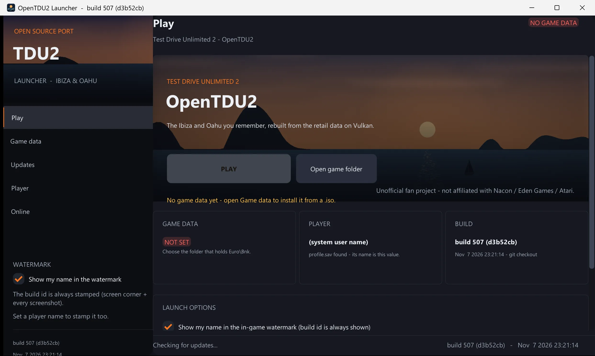

| Page | What it does |
|---|---|
| Play | The hero artwork, **PLAY** and the launch options. It starts the game exe beside it (or in `..\build-*\bin`) with `-game <folder>`, `-playername <name>`, `-tester <name>` (the watermark switch), `-userdata`, `-skipintro`, `-onlineusername` / `-onlineserver`. |
| Game data | Point at a **`.iso`** and extract the game, or pick an unpacked folder. The reader handles ISO 9660 + Joliet (Rock Ridge names, multi-extent files) and plain UDF 2.01-2.60; a hybrid disc is read through UDF when that works and falls back to ISO 9660. It looks for `Euro\Bnk` anywhere in the image and copies that folder out with progress, cancel and a resume that skips files already present at the same size. UDF 2.50 with a **metadata partition** (the Blu-ray layout) is not read - such images work here only through their ISO 9660 tree. A retail **packed** install (`bigfile_*.map` + `TDU2v*.big`) is detected and named, not unpacked: OpenTDU2 reads the unpacked layout. |
| Updates | The build stamp, a **changelog** and one click to update. A git checkout updates from `origin/<branch>`: the commits in between are the changelog and *Fast-forward this checkout* applies them (only on that branch, only when the tree is clean). A packaged build reads the GitHub releases of `<owner/repo>` (the release notes are the changelog); its first `.zip` asset is downloaded, unpacked with `tar.exe` and applied by a script that waits for the launcher to close, backs its exe up and restarts it. Every push to `main` also publishes an auto-tagged prerelease (`v0.2.<CI run number>`), so the newest integrated build is always the release the launcher offers. |
| Player | The **player name**: passed as `-playername`, written as `name` in `profile.sav` (the game applies it after loading an existing save) and used as the tester watermark. The page lists the save it found and opens the saves / mods folders. |
| Online | The **online account** (username, password, server) for the networking that does not exist yet. Saved in `launcher.ini` and passed as `-onlineusername` / `-onlineserver`; the game logs them, and nothing is transmitted today. The account is the online identity only - the nickname lives on the Player page. When a server exists, use a real password - until then, a throwaway one. |

`launcher.ini` sits beside the exe (UTF-16, so a non-ASCII name and a non-Latin path survive a save/load round
trip). The build id is always drawn top right in game and carried in the window title, every saved screenshot's
corner stamp and the log banner. The launcher's watermark switch adds the Player name beside it (`-tester`); it
cannot turn the build id off. `-nowatermark` hides the overlay for pixel-identical A/B runs only — the screenshots
still carry the corner stamp. See `RULES.md` §6.

The launcher also has headless modes, used by the verification below:

```bat
otdu2_launcher.exe --selftest               :: UTF-8 / JSON / launcher.ini / launch-argument checks
otdu2_launcher.exe --iso-info D:\TDU2.iso   :: list the image, read one file back (FNV-1a + dump)
otdu2_launcher.exe --check-update           :: the changelog, from git or the GitHub API
otdu2_launcher.exe --launch-test            :: start the game once with the launcher's arguments
:: add --log <path> to choose the report file (default %TEMP%\otdu2-launcher-selftest.log)
```

## Status: done and to do

| Area | Done | To do |
|---|---|---|
| Game files | `.bnk` banks, XMB (`XMBF`, both endians), encrypted `.cpr` (XTEA), database `db_data.cpr`, localisation `db_<lang>.cpr`, `SystemPC/GamePC/Physics/Quality_Settings.cpr`, `Default_KB.xmb` | `.big` archives, save games (format is in encrypted code) |
| Rendering | Vulkan (volk + VMA, MoltenVK); original `.sob` shaders translated D3D9 → SPIR-V for the 3D and the 2D layer; `.2db` (incl. cube maps), `.3dg`, `.3dd`, `.2dm`; `.UVA` texture animations; shadows (cascades + combine), post FX, haze, sky, clouds, weather presets; ocean with shore foam; GSReflection pool water (refraction / mirror projectors); interior day/night lightmaps; **the weather effects** — the falling rain (the retail WFX_Rain blocks / drop streaks / ground splashes, upstream's EdenRain ported), **rain on the windscreen** (the retail camera droplets over a `Droplets_Windshield` RT: refraction, rim glints, the wet film), the **wipers** (port-invented driver over the retail parked blade prim: hidden, split into halves and swung; the sweep clears the glass), **terrain puddles** that pool in the rain and dry away (the roads pool through the retail RainSpecs permutation), the invented `-snow` flake presentation (`docs/re/weather_effects_spec.md`) | Night lighting of the world, traffic lights, more post FX variants |
| World | Ibiza sectors and areas streaming, `.pmi` instances with the game's LOD factor, house spot placement, exteriors and interiors, **spot exteriors (dealerships, shops, houses) streamed in FREERIDE**; area grid from `worldconfig.cpr` (Ibiza 7 x 6, Hawai / Casino 11 x 9), sector unloading, island level heightfield (the tunnel / bridge carve: render split **and** drive-physics ground — the bore roads and floors carry the car, the dirt sheet no longer ramps it); **road-sign text** — the direction signs' destination names (the type-4 payloads of the A `.pmi` lists, `docs/re/sign_text_spec.md`) decoded and composed onto the blank plates of the `rs_maps` atlas (Arial lettering, TdirIb arrows, row pictograms, CPU DXT1 + mips, per-sign texture swap at draw; `-nosigntext` off, `-logsigns`, `-atsign [m]` test spawn; Hawai'i's signs are pre-baked in the data and need nothing) | Building collision, exterior LOD (`_low` banks), LOD meshes below LOD0, asynchronous loading |
| WORLD_VIEWER (tool) | Free-fly camera over Ibiza, Hawai or Casino (`launch_world_viewer.sh`), mouse look, WSAD, Shift x2, ImGui island switch, `spots.bin` teleport, spot exteriors, weathers | Traffic, roads / collision debug views |
| ASSET_VIEWER (tool) | Browse the game's **9,454 banks**: every asset with its **original Eden authoring path** (the data's opaque leaves identify themselves), size, type and group; **search every bank at once** (`-buildindex` writes a 30 MB index of 153,690 assets + 10,708 entities, then "ferrari" / "slot" / "cam_entree" finds the bank that holds it); an **Entities tab** showing every field of a bank's `entities.xmb` objects (cameras, actors, volumes, cinematics) and marking the selected one in the 3D view; **previews** — `2db` textures as images (one face of a cube map), `3dd` / `3dg` / `2dm` models on a **turntable** (bounds, mesh / vertex / triangle / material counts) with a **free camera**, a **view from the bank's own entity camera** (so an interior is not a box seen from outside) and a **collision wireframe** overlay, `vmf` movies in a panel sized Flash stage, `wav` sounds through `GSAudio`, `.cin` / `.sce` durations / shots / actors; **click a mesh and the asset that carries it is selected**, so a label can be written by pointing at it; a **label** + note per asset is written to `docs/re/asset_labels.txt`, and `-labellint` checks every key against the game data | Click-to-label inside a streamed island / spot scene, entity volumes as boxes (`docs/re/asset_viewer.md` §5) |
| CINVIEWER (tool) | Plays any cutscene of the scenarics banks (`-cinbank <bank> -cin <C_NAME>`, the same IntroCinematic player as the story): the **cinehud** (`-cinehud 0` off) — the shot timeline with the cut points and the Fx ticks (amber = the voice cues), the shot / time / active-camera readout; **pause + scrub** (the camera key pauses, the menu left / right step 0.5 s, the browser's slider seeks through `IntroCinematic::seekMain`, `-cinetime s` starts at a time); the **camera-path debug draw** (`-cinepaths`: every camera's Position keys, the actor paths and the scene origin axes projected through the active camera — pairs with `-cintopview` for placement); the **browser** (ImGui: the bank's cinematics click-to-play, a bank / cinematic pair to load, the scrub); `-logshots` / `-logscene` / `-logentities` dump the raw records. **Authored captions** (`cine_subtitles.h`): `<userdata>/cine_subtitles/<C_NAME>.csv` (`start,end,"text"`) drawn bottom-center during any scene (`-subtitles 0` off; the retail data ships no subtitle text — the `otdu2_cine_tool manifest` skeleton and `-cinesubdump` write the empty rows to fill) | The `.cin`/`.sce` write-back editor (STATE phase 3) |
| Flash UI | VMF reader, Eden fonts, display list, AVM1 ActionScript, buttons (keys + mouse), masks, EditText layout from the exe, `sbdd` localisation, font shader (TD_Flash PS #7), inline `#bitmap:` icons (`$$bitmaps$$` registry), `#command:` keys (orange `[key]` text on keyboard, like the original); **the pause screen** (MAIN.vmf drives its own menus — the icon row sits clear of the player card like the retail capture, the card's clock runs on the PC's time with the day / night icons and rolls on the minute, the money is formatted and refreshed live; `-clock HH.MM` freezes the time) | Pad key maps (the default X360 button binding is not in the data), some rare AVM1 opcodes |
| Audio | Eden mixer rebuilt from `audiosetup.xmb` (clients, routing matrices, mix presets, ducking), 3D positional sounds, cinematic Fx, voice banks per language | User volume sliders, ambiance emitters, engine sound model |
| Avatars | DBPNJ configs, bodies, heads, clothes, hair colours, body zones, skin constants (freckles, age, tone), skeleton animation with crossfades, style animations (m/w), avatar lighting (house lamps, camera light, shadow influence), driver seating (`IKOffsetDB.bin`, `stance_turn`, hand/foot/back IK targets), FaceFX facial animation in the intro / garage cinematics (`.fxa` actors, `.fxe` lip-sync curves, face graph, face shape sliders, expression normal maps) | FaceFX look-at, FaceFX outside the intro cinematics, finger grip and steering blend while driving |
| LOGIN | 3D press start cinematics, LOG_IN2.vmf, press start, "no progression data" popup | Profile / save game loading |
| AVATAR_CHOICE | C_INTRO with credits and slow motion, "Select your character" (6 candidates, transitions, slow-motion party and music), C_FIESTA_INTRO, first-person walk mode with Havok collisions, "Talk to Tess" → C_TESS → "Go to the garage", garage door | — |
| FIRST_WM (garage) | Garage intro, Tess and her voice lines, the California (roof down, cockpit LOD), tips ("Astuce") from `DBTutoMess`, door opening, enter the car, cockpit view with hands on the wheel, engine start → C_OUT / C_OUTRO | — |
| FREERIDE | Story step 2: C_FIRST_OUTRO, car on the road, driving (edVehicle drive train, controllers and aids from the exe, 90 Hz), collisions (roads, terrain, world objects), chase camera from `camerasingame.xmb`, HUD (goal, zone badge, GAUGES movie with the California rev counter, speed, gear, odometer, the **satnav** — the map renders under the HUD movie's own minimap screen art (`mmap_lure` is the retail engine's map quad: the bezel, the bottom band with the status icons and the inner frame draw over the map, the movie's `cursor` clip is the player marker, the movie's own `gps_distance` texts carry the distance left, the GPS route in the retail orange; docs/re/freeride_spec.md 7a), the **enter tiles** projected at the spot's screen position (the car-dealer plate, the carwash tile, the race tiles; the **return-to-road indicator** — the retail `/HUD/enter_hold` ring at the fixed top-centre position (the sky fill wiped through the ring's stencil mask, the loc 50 label under it, the red X lock state on a rejected on-road hold; the grass hold-A tile stays decoded — docs/re/backontrack_ui_findings.md) — shows off the network for 2 s, `-offroadhud` forces it), the popups auto-close like the retail (goal 30 s, hints, `close_popup`)), 90 s then white fade; the island's **buildings** (dealerships, shops, houses), the world map (flat island map, spots with the retail discovery law - icons appear as the car drives near, saved as knownspots_<island> - and every car dealer pin in its brand logo, the retail grabs law, docs/re/map_spots_spec.md, GPS route), the **dealership menu** (the retail layout: the shop list with the selected car's spec panel beside it — the Acceleration / Speed / Braking bars on the retail gauge ranges, the difficulty wheels, top speed / 0-100 / bhp — then the retail entries Buy / Get into the car / Data / Compare / Test drive; Data is the full data sheet, Compare records the car the others show against, Test drive runs GM_TestCar for 120 s and returns to FREERIDE at the dealer; the **near-car spec card** — a display car walked up to in the showroom or a traffic car stopped next to shows name, price and the three numbers), the radio (the 3 retail stations with their own playlists, plus **custom stations from `<Music>/OpenTDU2`**: the folder name is the station, its mp3 / ogg / opus / flac / wav files are the songs — the format is sniffed, not the extension — and `logo.png` / `logo.dds` is the art drawn on the panel) / in-car menu, the **photo camera** ("Take photo", PNG), **the car lights** (the retail light driver, docs/re/car_lights_spec.md: the lens materials' `GLOSSFCT` state — brake / reverse / position / blinker channels over the car's `*_lgt_g` mask + `*_lgt_on` lit art — so the lamps are dark by day, the position rings + headlamps light at night, the brake lights the red triangles + the third-light strip, the reverse the white wedges and the indicators blink their amber centres 0.6/0.4; the `Fa_`/`FA_` lamp glow quads and the BREAKING / REVERSING / HEADLIGHT ground-pool boxes follow their function, `-noflares` / `-nolightboxes` off — the boxes' TD_ShadowBox ground projection is still skipped by the renderer, and the **ground light pools** draw port-native instead — a soft warm quad ahead of every car with its lamps on (the player + the nearest traffic) and a red/white one behind on brake/reverse, corners on the carve-aware ground, `-noheadlights` off), **the animated windows** (the WND_x1 glass slides onto the door-frame rest) and the **night dashboard backlight** (`-night`, `-carlights 0|1|2` (0 dark, 1/2 forced on), `-indicator left|right|hazard`, `-logcarlights`); the **realtor** (the `ERE_*` agencies sell the 76 `DBHouse` houses of the three islands, buy / sell with the profile's money), **walking into your houses** (the `lph_*` living room in the house frame with its `myhouse` furniture, the `gph_*` garage with your cars on its slots, the map's home icon, `-home` spawns at the home house; **the living room loads in its island** — the exterior bank draws the shell around the room and the world streams with the ocean, the windows show the island, and the plot is **walkable with collision**: out of the front door across the yard (the island ground, the exterior bank's own walls and the sector statics push the walker — the garage building, the fences, the campsite) to the garage door's `Garage` volume, A swaps to the garage room, its `Living` volume walks back out at the yard door; docs/re/houses_spec.md 5.1-5.2), the **tuning shop** menu (the three levels per car) and the **paint / sticker shop** menu (the car's colour catalogue, live repaint; **the car wash** (the `ECW_*` spots, 3 on Ibiza / 5 on Hawai: the retail `carwash` tile of the enter element with the `Enter` action when stopped within 35 m, the retail hint 3913 once per approach, validate pays the $10 fee [INF: not in the readable data] and plays the bank's own washing cutscene `C_WASHING` through GM_CinViewer at the spot frame with the player's car in its owned paint, then FREERIDE resumes under the StoryHandoff where the scene left the car; `-nowash` off, `-atwash` test spawn, `-logwash`; docs/re/car_wash_spec.md - the scene's in-car camera (shot 2, 2.03-4.24 s) falls back to a NaN pose (parked, docs/re/car_wash_spec.md 8)) | Story step 3 "Meeting Tess", other cars, house purchase cinematics, the in-car satnav quad, the remaining shops' menus (surgery, club, airport ...), car storage per house garage |
| Developer cheats | `source/game/cheats.cpp`: a panel (**F4**, or a D-pad circle three times with X mashed on a pad - the retail dev-feature way in) with the profile's **money** and the casino chips, a **teleport** (the island's spots from `spots.bin`, raw coordinates, or **F5** on the map to the point the cursor is over), the weather preset and the story step, and the retail dev menu's **delock rows**: all cars (83 from `DBCarShop`), all houses, all roads (1 350 links / 100 %), **all spots** (the map icons discovery state), cars on stock (buyable), all achievements (189 `DBRewardXP` events), target nearest locked road; `-money` / `-chips` / `-cheat <rows>` / `-tpin` do the same from the command line (`docs/re/cheats.md`, `launch/15_Freeride_Cheats.bat`) | the retail menu's clothes / dealers rows have nothing to unlock in the port yet |
| Modding | The **mods overlay**: `<user data>/mods` mirrors the game layout and any file there shadows the game file of the same path — textures, shaders, audio, databases, UI movies and whole banks (`-mods <dir>` / `OTDU2_MODS_DIR`, `-nomods`). `tools/mod/add_spot.py` adds a **building**: one 0x110-byte record in a copy of the island's `spots.bin` plus its exterior bank, and the port places it (`docs/re/modding.md`, verified: `docs/images/mod-station-placed-s14.webp`). **Flash-art overrides**: `<mods>/flash/fla_<id>.png` (e.g. `fla_0822.png`) replaces any flash UI bitmap — the icon remake route for the arts the retail driver composes at runtime (the return-to-road badge's arrow; `FlashMovie::getBitmap` binds the override over the standalone / atlas page sources, `-dumpbot` writes the retail arts out as PNGs to trace them) | Our own mesh and textures still need the asset path — a port-native OBJ/glTF prop, or the Eden `.3dd`/`.3dg`/`.2dm`/`.2db` + a BNK packer + an exporter; a PC BNK **packer exists** (`tools/x360/build_bank.py` — the Eden island tree is its from-scratch output, `docs/re/eden_island_spec.md`); still missing: the mesh **exporter** and the `tools/bnk_tool` pack command (`tools/bnk_tool` itself only lists / extracts) |
| FREERIDE | Story step 2: C_FIRST_OUTRO, car on the road, driving (edVehicle drive train, controllers and aids from the exe, 90 Hz), collisions (roads, terrain, world objects), chase camera from `camerasingame.xmb`, HUD (goal, zone badge, GAUGES movie with the California rev counter, speed, gear, odometer, the **satnav** — the map renders under the HUD movie's own minimap screen art (`mmap_lure` is the retail engine's map quad: the bezel, the bottom band with the status icons and the inner frame draw over the map, the movie's `cursor` clip is the player marker, the movie's own `gps_distance` texts carry the distance left, the GPS route in the retail orange; docs/re/freeride_spec.md 7a), the **enter tiles** projected at the spot's screen position (the car-dealer plate, the carwash tile, the race tiles; the **return-to-road tile** — the retail grass-tuft + hold-button art with loc 50 — anchors on the nearest road when off the network for 2 s, `-offroadhud` forces it), the popups auto-close like the retail (goal 30 s, hints, `close_popup`)), 90 s then white fade; the island's **buildings** (dealerships, shops, houses), the world map (flat island map, spots with the retail discovery law - icons appear as the car drives near, saved as knownspots_<island> - and every car dealer pin in its brand logo, the retail grabs law, docs/re/map_spots_spec.md, GPS route), the **dealership menu** (the retail layout: the shop list with the selected car's spec panel beside it — the Acceleration / Speed / Braking bars on the retail gauge ranges, the difficulty wheels, top speed / 0-100 / bhp — then the retail entries Buy / Get into the car / Data / Compare / Test drive; Data is the full data sheet, Compare records the car the others show against, Test drive runs GM_TestCar for 120 s and returns to FREERIDE at the dealer; the **near-car spec card** — a display car walked up to in the showroom or a traffic car stopped next to shows name, price and the three numbers), the radio (the 3 retail stations with their own playlists, plus **custom stations from `<Music>/OpenTDU2`**: the folder name is the station, its mp3 / ogg / opus / flac / wav files are the songs — the format is sniffed, not the extension — and `logo.png` / `logo.dds` is the art drawn on the panel) / in-car menu, the **photo camera** ("Take photo", PNG), **the car lights** (the retail light driver, docs/re/car_lights_spec.md: the lens materials' `GLOSSFCT` state — brake / reverse / position / blinker channels over the car's `*_lgt_g` mask + `*_lgt_on` lit art — so the lamps are dark by day, the position rings + headlamps light at night, the brake lights the red triangles + the third-light strip, the reverse the white wedges and the indicators blink their amber centres 0.6/0.4; the `Fa_`/`FA_` lamp glow quads and the BREAKING / REVERSING / HEADLIGHT ground-pool boxes follow their function, `-noflares` / `-nolightboxes` off — the boxes' TD_ShadowBox ground projection is still skipped by the renderer, and the **ground light pools** draw port-native instead — a soft warm quad ahead of every car with its lamps on (the player + the nearest traffic) and a red/white one behind on brake/reverse, corners on the carve-aware ground, `-noheadlights` off), **the animated windows** (the WND_x1 glass slides onto the door-frame rest) and the **night dashboard backlight** (`-night`, `-carlights 0|1|2` (0 dark, 1/2 forced on), `-indicator left|right|hazard`, `-logcarlights`); the **realtor** (the `ERE_*` agencies sell the 76 `DBHouse` houses of the three islands, buy / sell with the profile's money), **walking into your houses** (the `lph_*` living room in the house frame with its `myhouse` furniture, the `gph_*` garage with your cars on its slots, the map's home icon, `-home` spawns at the home house), the **tuning shop** menu (the three levels per car) and the **paint / sticker shop** menu (the car's colour catalogue, live repaint; **the car wash** (the `ECW_*` spots, 3 on Ibiza / 5 on Hawai: the retail `carwash` tile of the enter element with the `Enter` action when stopped within 35 m, the retail hint 3913 once per approach, validate pays the $10 fee [INF: not in the readable data] and plays the bank's own washing cutscene `C_WASHING` through GM_CinViewer at the spot frame with the player's car in its owned paint, then FREERIDE resumes under the StoryHandoff where the scene left the car; `-nowash` off, `-atwash` test spawn, `-logwash`; docs/re/car_wash_spec.md - the scene's in-car camera (shot 2, 2.03-4.24 s) falls back to a NaN pose (parked, docs/re/car_wash_spec.md 8)) | Story step 3 "Meeting Tess", other cars, house purchase cinematics, the in-car satnav quad, the remaining shops' menus (surgery, club, airport ...), car storage per house garage |
| Developer cheats | `source/game/cheats.cpp`: a panel (**F4**, or a D-pad circle three times with X mashed on a pad - the retail dev-feature way in) with the profile's **money** and the casino chips, a **teleport** (the island's spots from `spots.bin`, raw coordinates, **F5** on the map to the point the cursor is over, or the **destinations row**: Airport, Casino, Ferrari dealer, Any dealer, Tuning shop, Car wash, Race school, Clothes shop - each resolved from the island's own `EAIR_*` / `EGAMHA` / `ECD_*` / `ETUN_A` / `ECW_A` / `ERS_A` / `EAS_A` banks), the weather preset and the story step, and the retail dev menu's **delock rows**: all cars (83 from `DBCarShop`), all houses, all roads (1 350 links / 100 %), **all spots** (the map icons discovery state), cars on stock (buyable), all achievements (189 `DBRewardXP` events), target nearest locked road; `-money` / `-chips` / `-cheat <rows>` / `-tpin` / `-tpdestination <name>` do the same from the command line (`docs/re/cheats.md`, `launch/15_Freeride_Cheats.bat`) | the retail menu's clothes / dealers rows have nothing to unlock in the port yet |
| Modding | The **mods overlay**: `<user data>/mods` mirrors the game layout and any file there shadows the game file of the same path — textures, shaders, audio, databases, UI movies and whole banks (`-mods <dir>` / `OTDU2_MODS_DIR`, `-nomods`). `tools/mod/add_spot.py` adds a **building**: one 0x110-byte record in a copy of the island's `spots.bin` plus its exterior bank, and the port places it (`docs/re/modding.md`, verified: `docs/images/mod-station-placed-s14.webp`) | Our own mesh and textures still need the asset path — a port-native OBJ/glTF prop, or the Eden `.3dd`/`.3dg`/`.2dm`/`.2db` + a BNK packer + an exporter; a PC BNK **packer exists** (`tools/x360/build_bank.py` — the Eden island tree is its from-scratch output, `docs/re/eden_island_spec.md`); still missing: the mesh **exporter** and the `tools/bnk_tool` pack command (`tools/bnk_tool` itself only lists / extracts) |
| Modding | The **mods overlay**: `<user data>/mods` mirrors the game layout and any file there shadows the game file of the same path — textures, shaders, audio, databases, UI movies and whole banks (`-mods <dir>` / `OTDU2_MODS_DIR`, `-nomods`). `tools/mod/add_spot.py` adds a **building**: one 0x110-byte record in a copy of the island's `spots.bin` plus its exterior bank, and the port places it (`docs/re/modding.md`, verified: `docs/images/mod-station-placed-s14.webp`). **Flash-art overrides**: `<mods>/flash/fla_<id>.png` (e.g. `fla_0812.png`) replaces any flash UI bitmap — the icon remake route for the arts the retail driver composes at runtime (no longer needed for the return-to-road badge: the retail art is `hud` bitmap 812 of `/HUD/BOT`; `FlashMovie::getBitmap` binds the override over the standalone / atlas page sources, `-dumpbot` writes the retail arts out as PNGs to trace them) | Our own mesh and textures still need the asset path — a port-native OBJ/glTF prop, or the Eden `.3dd`/`.3dg`/`.2dm`/`.2db` + a BNK packer + an exporter; a PC BNK **packer exists** (`tools/x360/build_bank.py` — the Eden island tree is its from-scratch output, `docs/re/eden_island_spec.md`); still missing: the mesh **exporter** and the `tools/bnk_tool` pack command (`tools/bnk_tool` itself only lists / extracts) |
| Not started | | Online, multiplayer, Hawai gameplay (both islands can be flown over in WORLD_VIEWER), challenges, races, phone |
| CASINO (offline) | The casino floor, the **slot machine** (5 reels x 3 rows, 9 paylines, per-line bet), **roulette** (single zero, straight to dozens, Rebet) and **video poker** (9/6 Jacks or Better, hold / draw), a chip wallet saved in the profile, the retail casino pause list, entry from the island at the `gamblinghall` spot, and the **casino progression from the game's own data**: 145 `DBCasinoObjectiveDetail` objectives tracked live, the `DBCasinoLevel` axes / levels, the `DBCasinoReward` / `DBCasinoUnlockable` rewards (cocktails, emotes, cars), the VIP / ACE status ladder, and a **Game Progress page** listing all 145 objectives per axis with their live counters | The online casino modes (Sit & Go, tournaments, private tables, friends, cocktails with other players, the race — their objectives load but cannot complete offline), the 3D casino island interior, the arrival / departure cinematics. The retail `Casino.vmf` shell loads but must not be drawn under the native screens (`docs/re/casino_spec.md` §5) |

## Grey areas: what is approximate and why

The rule of the project is to read behaviour from the data or from the readable code. The items below could not be
read completely, mostly because the code that decides them is in the SecuROM-encrypted part of the executable.
Each one is marked `[INF]` (inferred) in the sources and documented in `docs/re/`.

| Topic | What is approximate | Why |
|---|---|---|
| Car driving | The chassis constraint solver (contact / suspension force law, rigid body integration), the RK4 combination of the drive train stages, the contact coupling of the tyres to the chassis, a few predicates (idle / limiter thresholds, ABS / TC activation, shift speed getters), wheel and chassis inertia, ground materials (grass = terrain) | TDU2 cars use Eden's own `edVehicle` library, not the Havok vehicle SDK. The 90 Hz step, the drive train (engine torque / damping / speed clamp, clutch, gearbox, open differential with its bias limit, wheel axles with the car inertia share and the tyre torque at every stage), the engine / clutch / gearbox controllers (automatic shifts at the red / blue lines), ABS / traction control / hand brake regulation, aero anchors and damping curves are read from the code; the chassis core of `edVehicle` is in the encrypted part (see `docs/re/vehicle_physics_spec.md` §6 - 7) |
| Chase camera | Camera motion (lag, lean, shake) | Positions and FOV come from `camerasingame.xmb`; the update code was not found |
| HUD | Minimap road drawing, zone lookup, which gauge-bank texture is the dial / the needle, in-car DASHBRD screen not drawn | Map drawing and zone lookup are encrypted; texture arguments are lost in the readable code |
| Car radio | The retail stations' song split (the 65 songs of `sound/radio/music` dealt round robin over Hariba / Kalua / Roadtrack), the artist and title from the file name, the jingles / DJ comments / ads not played | `sound/radio/setup.xmb` is one flat list, so the retail per-station split is not in the readable data |
| Walk mode | Mouse sensitivity, body radius (0.3 m), step height, strafing on left/right | The walk controller and its camera are encrypted; speeds and head limits come from `avatarsdriver.bnk` |
| Tips and goals | When each tip opens and closes; "Talk to Tess" shown when walk mode starts | Texts and delays come from `DBTutoMess`; the trigger conditions are encrypted |
| Seated avatar | The IK solver (analytic two-bone), seat adjustment added to the seat node, head hidden in the cockpit view | Seat node, `IKOffsetDB.bin` offsets, driving clip and IK targets come from the data and readable code; the Havok IK solver, the seat move and the cockpit render branch are encrypted |
| Avatar lighting | Lamp distance fall-off (linear from DropOff to CutOff), light sample point (feet + 1 m), camera axis | Small helper functions are encrypted; everything else follows the readable code |
| 3D sound | Attenuation curve and panning law | The edAudio spatializer is encrypted; distances, clients and matrices come from the data |
| Cinematics | Shot fade parameters, start-of-cinematic skip input, roof state in the garage (open, from the general convertible rule) | Read from data and partial code; the shot / scene code (CinScene) is encrypted |
| Pool reflections | Avatars in the mirror layers are on | The intro-mode check is encrypted; the original layer setup includes them |
| Ocean | Finest-level-wins between the island, area and sector ocean tiles is the port's [INF] rule (the area tiles now draw per sector group and hide under their own loaded sector); the foam sampler's per-axis addressing is [INF] | The encrypted level manager chooses the retail tiles; the 2DM sampler byte meaning is mapped for the known values only |
| World viewer | Island level heightfield (`<island>.bnk`, 384 m grid) drawn where no area is loaded; spot exteriors placed from `spots.bin` (bank name -> `exterior/<name>.bnk`, position, heading); streaming distances and camera speeds | The level LOD selection is encrypted; the tool values (speeds, distances, sensitivity) are OpenTDU2's own, the wheel steps come from OpenTDU |
| Animations | Walking clips "jump" at their loop point | This is the game data itself: the readable time controller wraps exactly like OpenTDU2 |

## Code layout

```
source/
  core/          logger, assert, maths, memory, XMB, CPR crypto
  system/        command line
  filesystem/    GSFile (game root, case-insensitive paths), Bank (.bnk)
  config/        GSConfig (SystemPC / GamePC / Physics / Quality_Settings .cpr)
  database/      GSDatabase (db_data.cpr, localisation)
  input/         GSInput (Default_KB.xmb, keyboard, mouse, gamepad)
  audio/         GSAudio (Eden mixer, audiosetup.xmb, 3D sound)
  render/        GSRender, Vulkan device, 2DB/3DG/3DD/2DM, texture cache, Renderer2D, Eden renderer
    eden/        original-shader renderer, scene view, shadows, post FX, ocean, sky, planar reflections
    shaders/     ShaderLibrary (.sob), DXSO -> SPIR-V, FlashShaderPipeline (TD_Flash.sob)
  flash/         VMF reader, FlashMovie, FlashPlayer (AVM1), localisation
  physics/       GSPhysics (Jolt), Havok .shk/.dhk collision reader, vehicle data / dynamics / collision
  world/         EdenWorld (sectors, .pmi instances, ocean tiles)
  game/          game modes: bootmenu (LOGIN), avatarchoice (AVATAR_CHOICE), firstwalkmode (FIRST_WM),
                 freeride (FREERIDE), casino (CASINO, offline: slots + roulette), worldviewer (WORLD_VIEWER
                 tool), uiviewer (UI_VIEWER tool: the frontend's flash display list as data);
                 walkmode, cinematics, cars, avatars, player profile
  tdu_instance.* main loop, services, game mode switching
third_party/dxvk DXVK's DXSO compiler (zlib licence), adapted (see OpenTDU)
tools/           otdu2_bnk_tool (list/extract/decrypt/xmb), otdu2_sob_tool (dump + SPIR-V translation),
                 otdu2_cine_tool (cutscene .cin/.sce dump + manifest: shots, cameras, scene origins,
                 resolved assets / characters / voicelines / story placements),
                 otdu2_launcher (the GUI launcher: .iso install, changelog updater, player name, watermark)
docs/            file formats (docs/formats.md) and reverse-engineering notes (docs/re/*.md)
```

Tools:

```sh
./build/bin/otdu2_bnk_tool list    Euro/Bnk/Vehicules/High/california.bnk
./build/bin/otdu2_bnk_tool extract Euro/Bnk/FrontEnd/HiRes/main.bnk out/
./build/bin/otdu2_bnk_tool decrypt Euro/Bnk/Database/db_data.cpr db_data.xmb
./build/bin/otdu2_sob_tool Euro/Shaders/TD_CarPaint.sob out/      # .dxso + .spv per shader
./build/bin/otdu2_cine_tool dump /path/to/TestDrive2 _cine_dump -json   # one .md (+ .json) per cutscene
./build/bin/otdu2_cine_tool manifest /path/to/TestDrive2 _cine_manifest -json
                                 # dump plus the resolved layers: scene REFS -> bank assets,
                                 # objects -> entities (PNJ characters + DBPNJ outfits), Fx -> .bfx
                                 # -> per-language wav names, the message protocol (known vs [ENC]),
                                 # story placements, the avatar ruling; + a subtitle skeleton CSV
                                 # per cinematic (<userdata>/cine_subtitles/<C_NAME>.csv.skeleton)
```

For testers there is `otdu2_launcher.exe` (in `<build>/bin/`, beside the game exe — a
distribution is those two files plus the tester's own game data): a small Windows GUI
that asks for the game-data folder (validated against the `Euro\Bnk` rule
`GSFile::findGameRoot` uses) and the tester's name, remembers both in `launcher.ini`
beside itself, and starts the game with `-game <folder>` plus the name as both
`-playername` (the avatar's) and `-tester` (the top-right watermark + the window
title). An empty name launches plain and clean.

## Credits

**Project**

* [Danny19901](https://github.com/danny199012) — the port: engine, tools, launcher, everything between
* [CamilleKMI](https://github.com/CamilleKMI) — [OpenTDU2](https://github.com/CamilleKMI/OpenTDU2), the upstream this tree continues

**Built with the help of (AI assistants)**

* GLM 5.3 Flash (Z.ai)
* Claude Opus 5.5 / Sonnet 5.5 (Anthropic)
* DeepSeek v4.1 Flash (DeepSeek)

**Community — keeping TDU alive**

* xXBeefyDjXx · Xarlith · AlexVII · Milli · .Galopin

**The game**

* *Test Drive Unlimited 2* — developed by **Eden Games**, published by **Atari**
* The *Test Drive* brand — **Nacon**
* Unofficial and not affiliated with or endorsed by any of them — see [NOTICE](NOTICE) and
  [Legal notice](#legal-notice).

## Licence

This repository's own code is licensed under the **GNU General Public License,
version 3 or later** — see `LICENSE`. That is a *copyleft* licence: you may fork,
use and modify it freely, but if you distribute it (or something built from it)
you must keep the notices intact and publish your version under the same licence
with its source. There is no warranty.

**Read `NOTICE` before reusing anything** — it scopes the licence honestly:

* *Test Drive Unlimited 2* and its data belong to their respective owners; **no
  game data is included**, and the GPL cannot license it.
* The in-game screenshots under `docs/images/` are derived from the game and are
  **not** covered by the GPL; the supporting data dumps extracted from the game
  are kept locally and not committed.
* `third_party/dxvk` is **zlib** (see `third_party/dxvk/LICENSE`); the other
  dependencies are fetched at configure time under their own licences.
* This tree continues the upstream **OpenTDU2** project
  (https://github.com/CamilleKMI/OpenTDU2), which carries no licence of its own;
  the GPL here covers this repository's own contributions.

